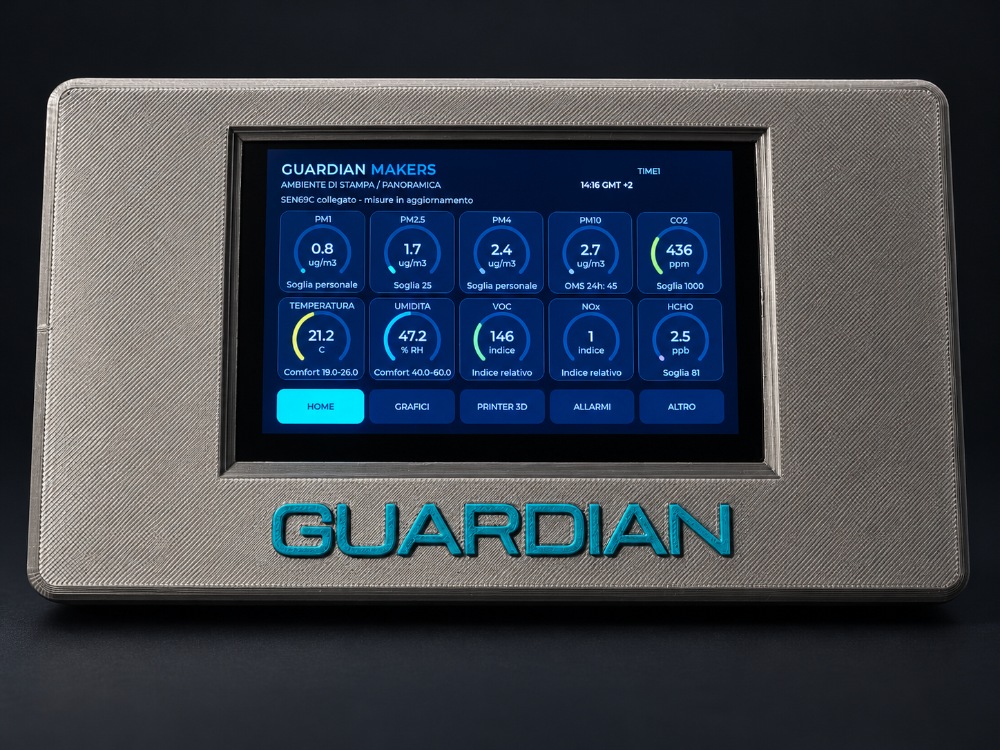

# GUARDIAN MAKERS

## Ultimi aggiornamenti / Latest updates

**Nuova funzione: Verifica e correzioni.** Menu tecnico protetto da PIN per confrontare le letture con strumenti di riferimento, gestire le correzioni e consultare il registro tecnico. Include le operazioni dedicate alla CO2. Non equivale a una certificazione del dispositivo.

**New feature: Verification and corrections.** A PIN-protected technical menu for reference comparisons, correction profiles, dedicated CO2 operations and a technical log. This does not constitute device certification.

**29 ottobre 2026:** documenti organizzati per lingua, indice download e video. Edizione documentale: **28 ottobre 2026**.

**[Leggi tutte le ultime modifiche / Read the latest changes](CHANGELOG.md)**

**[Indice documenti / Document index](docs/README.md)**

**Monitoraggio ambientale per spazi maker e stampa 3D · Environmental monitoring for maker spaces and 3D printing**

## Documentazione italiana

Edizione aggiornata **28 ottobre 2026**.

- [Presentazione PDF](docs/it/GUARDIAN_Presentazione_IT.pdf)
- [Presentazione PowerPoint](docs/it/GUARDIAN_Presentazione_IT.pptx)
- [Manuale di installazione e utilizzo PDF](docs/it/GUARDIAN_Manuale_IT.pdf)
- [Video di presentazione in italiano (MP4)](video/GUARDIAN_Video_IT.mp4)

GUARDIAN affianca le misure ambientali all'andamento della stampa, con storico, esportazione dei dati e consultazione da PC e smartphone. Questo repository contiene esclusivamente la documentazione pubblica: firmware e progetti meccanici non sono inclusi.

Il collaudo del collegamento alla stampante è stato eseguito con Bambu Lab A1 e X1 Carbon. Il collegamento utilizza i protocolli Bambu Lab; la compatibilità con altri modelli deve essere verificata. Altri marchi non sono dichiarati supportati.

GUARDIAN è un dispositivo di monitoraggio, non uno strumento di misura professionale certificato. Per il confronto con i riferimenti PM su 24 ore occorrono 24 ore complete di registrazione valida. Le schermate mostrano dimostrazioni reali anche su periodi parziali: valori bassi non attestano da soli la sicurezza dell'aria. Fonti, condizioni e limiti sono descritti nei documenti.

## English documentation

Updated edition **28 October 2026**.

- [PDF presentation](docs/en/GUARDIAN_Presentation_EN.pdf)
- [PowerPoint presentation](docs/en/GUARDIAN_Presentation_EN.pptx)
- [Installation and user manual PDF](docs/en/GUARDIAN_Manual_EN.pdf)
- [English presentation video (MP4)](video/GUARDIAN_Video_EN.mp4)

GUARDIAN brings environmental readings together with printing progress, historical data, export features and access from computers and smartphones. This repository contains public documentation only; firmware and mechanical design files are not included.

Printer connectivity was tested with Bambu Lab A1 and X1 Carbon and uses Bambu Lab protocols. Compatibility with other models requires verification; support for other brands is not claimed.

GUARDIAN is a monitoring device, not a certified professional measuring instrument. Comparison with 24-hour PM references requires a full 24 hours of valid recording. The screenshots show real demonstrations, including partial recording periods: low readings alone do not establish that the air is safe. Sources, conditions and limitations are explained in the documents.

Both presentations contain 40 slides. Device photographs retain the original on-screen language; English explanations accompany them.

---

Per seguire gli aggiornamenti / To follow updates: **Watch** this repository.

[Provenienza e diritti / Attribution and rights](NOTICE.md)
